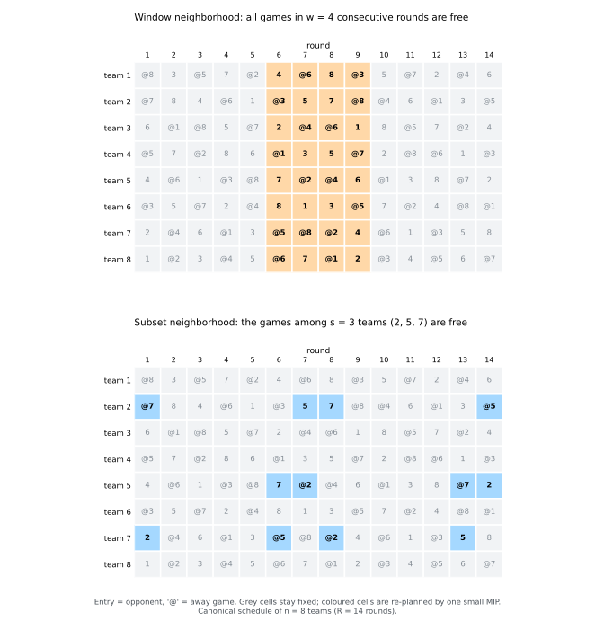
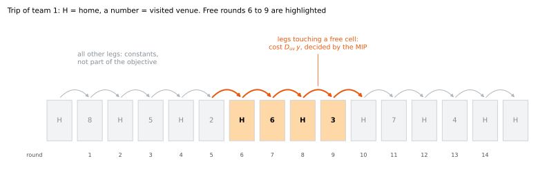
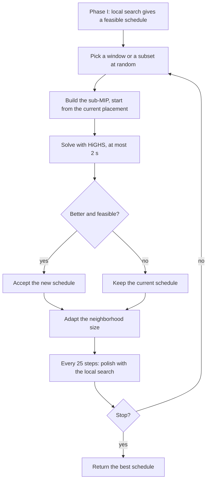

# pyttp

🏈 A hybrid local search and MIP heuristic for the **t**raveling **t**ournament **p**roblem.

Given `n` teams (`n` even) and a distance matrix `D`, where `D[i, j]` is the distance from team
`i` to team `j`, find a
[double round robin tournament](https://en.wikipedia.org/wiki/Round-robin_tournament) such that

- no team plays more than `max_k` consecutive home games or more than `max_k` consecutive away games,
- no two teams play each other in two consecutive rounds, and
- the total distance traveled by all teams is minimal. Every team starts and ends at home.

The algorithm is a hybrid. Starting from a canonical schedule, a greedy local search in C++
(phase I) improves the solution. Phase II then improves the result further and can be chosen with
`phase2`:

- **`"lns"` (default): large neighborhood search.** It repeatedly frees a few rounds or the games
  among a few teams and re-optimizes just those games exactly with a small MIP. The model stays
  small (a few hundred binaries) however many teams there are, so it works up to 30+ teams. Neighborhood sizes adapt
  to the solve times; the local search polishes the result between rounds. The mathematics is
  explained in [How the LNS works](#how-the-lns-works).
- **`"mip"`: global MIP.** The approach of
  [M. Goerigk and S. Westphal](https://link.springer.com/article/10.1007%2Fs10479-014-1586-6):
  alternately optimize the pairings and the home-away pattern with one MIP over the whole
  problem. It only fits small instances, the model has millions of rows for 32 teams.

The local search is implemented in C++23 and exposed with [nanobind](https://github.com/wjakob/nanobind).
The MIPs are solved by [HiGHS](https://highs.dev) through [python-mip](https://github.com/coin-or/python-mip),
so no commercial solver is needed.

### Solution quality

Measured with `benchmarks/bench_quality.py` on the classic benchmark instances (see
`benchmarks/instances`), `max_k=3`, seed 0, one run each. The gap is relative to the best known
upper bound of the [RobinX repository](https://www.sportscheduling.ugent.be/RobinX/travelRepo.php).

| Instance | Teams | Time limit | Objective | Best known | Gap |
|---|---:|---:|---:|---:|---:|
| NL4 | 4 | none | 8,276 | 8,276 | 0% (proven optimal) |
| NL12 | 12 | 30 s | 133,682 | 110,729 | 20.7% |
| NL16 | 16 | 30 s | 346,768 | 261,687 | 32.5% |
| NFL16 | 16 | 60 s | 297,529 | 231,483 | 28.5% |
| NFL24 | 24 | 60 s | 570,044 | 463,657 | 22.9% |
| NFL32 | 32 | 60 s | 1,281,078 | 914,620 | 40.1% |

This is a practical heuristic, not a state-of-the-art solver: the best known values come from
specialised algorithms that run for hours. On small instances the search stalls in a local optimum
(it only accepts improvements) and further time does not help. For comparison, the global MIP
mode (`phase2="mip"`) ends 46.2% above the best known on NFL16 in 60 s (LNS: 28.5%), and its model
is too large to be useful for 32 teams.

## Install

```bash
pip install pyttp
```

Wheels are published for CPython 3.11 to 3.14 on Linux (glibc, x86_64 and aarch64), macOS
(x86_64 and arm64) and Windows (x86_64).

## Example

```python
import logging

import numpy as np
import pyttp

logging.basicConfig(level=logging.INFO)  # progress is reported through the "pyttp" logger

team_names = ["ATL", "NYM", "PHI", "MON"]
distances = np.array(
    [[0, 745, 665, 929], [745, 0, 80, 337], [665, 80, 0, 380], [929, 337, 380, 0]],
    dtype=np.int32,
)

solution = pyttp.solve(distances, max_k=3, time_limit=60)  # time_limit is optional
print(solution.objective)  # 8276
pyttp.print_schedule(solution.schedule, team_names)
```

```none
Slot   ATL  NYM  PHI  MON
   0  @MON  PHI @NYM  ATL
   1  @NYM  ATL @MON  PHI
   2  @PHI @MON  ATL  NYM
   3   MON @PHI  NYM @ATL
   4   NYM @ATL  MON @PHI
   5   PHI  MON @ATL @NYM
```

A schedule is an `int32` array of shape `(n, 2n - 2)`. Entry `[t, r]` describes the game of team
`t` in round `r` (both 0-based): `abs(entry) - 1` is the opponent, a positive sign is a home game
and a negative sign an away game.

### API

| | |
|---|---|
| `pyttp.solve(distances, max_k=3, max_phase1_runs=10, max_mip_gap=0.05, time_limit=None, phase2="lns", seed=None, lns_patience=100)` | Run the hybrid heuristic, returns a `Solution(objective, schedule)`. `time_limit` (seconds): return the best schedule found when the budget is used up. `phase2`: `"lns"` or `"mip"`. `seed`: random neighborhood choice of `"lns"`. `lns_patience`: without a time limit, stop after this many fruitless neighborhoods. `max_mip_gap` only affects `"mip"`. |
| `pyttp.objective(schedule, distances)` | Total travel distance of a schedule. |
| `pyttp.satisfies_stand_limits(schedule, max_k)` | Checks the home stand and road trip limit. |
| `pyttp.has_repeaters(schedule)` | True if some pair of teams plays in two consecutive rounds (forbidden). |
| `pyttp.is_feasible(schedule, max_k)` | All rules at once: valid tournament, stand limits, no repeaters. |
| `pyttp.is_valid_schedule(schedule)` | Checks that a schedule is a valid double round robin. |
| `pyttp.canonical_schedule(n)` | The canonical start schedule. |
| `pyttp.neighborhoods` | `swap_homes`, `swap_rounds`, `swap_teams`, `partial_swap_rounds`, `partial_swap_teams`. |

## How the LNS works

Phase II (`phase2="lns"`) is a *large neighborhood search*: it repeatedly frees a small part of the
current schedule and re-plans just that part optimally with a MIP, keeping the rest fixed. This
section states the underlying optimization problem and shows why the sub-problems stay small.

### The TTP as a MIP

Let $T=\{1,\dots,n\}$ be the teams, $m=2n-2$ the number of rounds and $k$ the maximum length of a
home stand or road trip (`max_k`). A *game* $g=(a,h)$ is "team $a$ plays away at the venue of team
$h$"; there are $n(n-1)$ of them, and each is played exactly once. The binary variable
$x_{g,r}=1$ puts game $g$ into round $r$. Team $t$ is at venue $z_{t,v,r}=1$ in round $r$:

$$
z_{t,t,r}=\sum_{a\ne t}x_{(a,t),r},\qquad z_{t,v,r}=x_{(t,v),r}\ \ (v\ne t),\qquad z_{t,t,0}=z_{t,t,m+1}=1,
$$

where the last two terms say that every team starts and ends at home. A *leg* is the trip of one
team between two consecutive rounds, from venue $u$ to venue $v$; it costs $D_{uv}$.

$$
\begin{aligned}
\min\quad & \sum_{t\in T}\ \sum_{r=0}^{m}\ \sum_{u,v\in T} D_{uv}\,y_{t,u,v,r}
&& \text{total travel distance}\\
\text{s.t.}\quad & y_{t,u,v,r}\ \ge\ z_{t,u,r}+z_{t,v,r+1}-1,\quad y\ge 0
&& \text{leg } u\to v \text{ is travelled}\\
& \sum_{r=1}^{m}x_{g,r}=1 && \forall g\\
& \sum_{g\ni t}x_{g,r}=1 && \forall t,\ r \quad\text{(one game per round)}\\
& \sum_{s=r}^{r+k}\sum_{h\ne t}x_{(t,h),s}\le k,\quad
  \sum_{s=r}^{r+k}\sum_{a\ne t}x_{(a,t),s}\le k && \forall t,\ r \quad\text{(stand limits)}\\
& \sum_{s\in\{r,r+1\}}\bigl(x_{(i,j),s}+x_{(j,i),s}\bigr)\le 1 && \forall i<j,\ r \quad\text{(no repeaters)}\\
& x_{g,r}\in\{0,1\}
\end{aligned}
$$

Because $D\ge 0$, the objective pushes $y$ down to $\max\{0,\,z_u+z_v-1\}=z_u z_v$, so $y$ can be
continuous. The model has $n(n-1)m$ binaries and $n^3(m-1)$ linking constraints, which is $61{,}504$ and
$1{,}998{,}848$ for $n=32$: far too large to solve (or even build) directly.

### Re-planning a part: the free-cell sub-problem

Take a feasible schedule $\bar S$ and a set of *free cells* $F\subseteq T\times\{1,\dots,m\}$
(cell $(t,r)$ is the game of team $t$ in round $r$) such that both teams of a game have a free cell
in the same rounds. Let $G_F$ be the games of $\bar S$ that sit in free cells, and
$A_g=\{r:\ (a,r)\in F\text{ and }(h,r)\in F\}$ the rounds in which game $g=(a,h)$ may be played.
**Only $x_{g,r}$ with $g\in G_F$ and $r\in A_g$ are variables.** Everything else is a constant, and
the model keeps the same structure:

$$
\begin{aligned}
\min\quad & \sum_{(t,r)\in L_F}\ \sum_{u,v} D_{uv}\,y_{t,u,v,r}\\
\text{s.t.}\quad & \sum_{r\in A_g}x_{g,r}=1 && \forall g\in G_F\\
& \sum_{g\ni t,\ r\in A_g}x_{g,r}=1 && \forall (t,r)\in F\\
& \sum_{s\in W,\ (t,s)\in F}\ \sum_{h}x_{(t,h),s}\ \le\ k-\bar a_{t,W}
&& \text{stand limits, windows } W=\{r,\dots,r+k\} \text{ with a free cell of } t\\
& \mu_{t,o,r}+\mu_{t,o,r+1}\le 1 && \text{no repeaters}\\
& y_{t,u,v,r}\ \ge\ z_{t,u,r}+z_{t,v,r+1}-1,\quad y\ge 0 && \forall (t,r)\in L_F
\end{aligned}
$$

- $\bar a_{t,W}$ is the number of *fixed* away games of team $t$ in window $W$ (analogously for home
  games), so the stand limit also sees the fixed games next to the free ones.
- $\mu_{t,o,s}$ is "team $t$ plays $o$ in round $s$": a sum of variables if the cell is free, and the
  constant $0$ or $1$ if it is fixed.
- $L_F$ contains only the legs that touch a free cell, i.e. $(t,r)\in F$ or $(t,r+1)\in F$. For a
  leg with one fixed end, $z$ of that end is a constant and the term is linear. All other legs are
  constants and are left out (see the second figure).

Two properties make this a sound building block:

1. **Exact.** The legs left out are the same for every placement of the free games, so the
   objective of the sub-problem differs from the true objective by a constant: improving the
   sub-problem improves the schedule by exactly the same amount (this is checked in the tests).
2. **Never worse.** The current placement is feasible for the sub-problem, so its optimum is at
   least as good as the current schedule (the placement is also given to the solver as a start).



### The two neighborhoods

- **Window** $W(a,w)$: $F=T\times\{a,\dots,a+w-1\}$. All games of $w$ consecutive rounds are
  re-placed among those rounds: $nw/2$ games with $w$ allowed rounds each, i.e. about $nw^2/2$
  binaries (256 for $n=32$, $w=4$).
- **Subset** $S\subseteq T$ with $|S|=s$: $F=\{(t,r):\ t\in S\text{ and the opponent of }t\text{ in round }r\text{ is in }S\}$.
  The $s(s-1)$ games among the teams of $S$ are re-placed: game $(a,h)$ may move to any round in
  which both $a$ and $h$ currently play a team of $S$ (roughly 200 to 300 binaries for $n=32$, $s=8$, depending on the teams).

In both cases the size is governed by $w$ or $s$, not by the number of rounds. A window grows only
linearly with $n$ (compare $n^3$ for the global model) and a subset does not grow with $n$ at all.
If $F$ covers everything ($w=m$ or $s=n$) the sub-problem is the whole TTP; when it
is solved to optimality, the solution is optimal and the search stops.



### The search



- **Neighborhoods alternate** between window and subset; positions and teams are drawn uniformly
  at random (`seed`). Windows start with $w=3$ rounds, subsets with $s=4$ teams.
- **Sizes adapt.** A neighborhood shrinks by one if its sub-MIP was not proven optimal within the
  2 s limit or needed more than a quarter of it, and grows by one after 10 fruitless solves at its
  current size. Small, cheap neighborhoods gave the most improvement per second in the
  experiments (making them grow as soon as solves were cheap gave worse schedules in every run).
- **Stopping.** The search ends at `time_limit`; without one, after `lns_patience` fruitless
  neighborhoods in a row, or earlier when optimality is proven. Only strict improvements that pass
  `is_feasible` are accepted, so the result always satisfies all rules.

## Development

```bash
uv sync                  # builds the extension in editable mode (needs a C++23 compiler)
uv run pytest
uv run ruff check . && uv run ruff format .
uv run pyrefly check
clang-format -i src/cpp/*.cpp src/cpp/*.hpp
uv build                 # sdist + wheel in dist/
```

### Benchmarks

`benchmarks/bench_core.py` times the native core (objective, every neighborhood move, local search
steps and descents; no MIP) on fixed random instances:

```bash
uv run python benchmarks/bench_core.py --output result.json
```

The `Benchmark` workflow builds the base and the head of every pull request on the same runner,
runs the script alternately against both and posts a comparison table (`benchmarks/compare.py`) to
the job summary. Slowdowns above 10% show up as warnings on the PR. Run-to-run noise is around
3-4%. Pass `--fail-above PERCENT` to `compare.py` to turn regressions into failures.

Local builds are compiled with `-march=native` (`/arch:AVX2` on MSVC). Release wheels turn this
off (`-DPYTTP_NATIVE=OFF`, see `[tool.cibuildwheel]` in `pyproject.toml`), because they have to run
on every CPU. To opt out locally, build with `CMAKE_ARGS="-DPYTTP_NATIVE=OFF" uv build`.

The version is derived from git tags (`git tag v0.1.0`). Pushing a `v*` tag builds all wheels with
cibuildwheel and uploads them to TestPyPI via Trusted Publishing.
